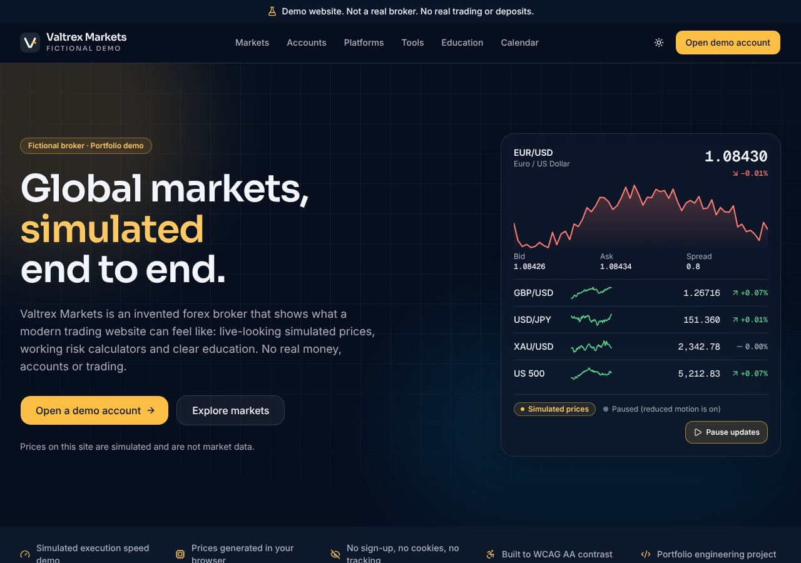

# forex-broker-site-demo

**Valtrex Markets** is a polished marketing website for a forex broker that **does not exist**.
It is a portfolio demo by **Emmanuel Kelvin**, full-stack developer.

> **Disclaimer:** Demo website. Not a real broker. No real trading or deposits. Valtrex Markets is
> an invented brand with no company, licence or regulator behind it. Every price is simulated in
> your browser, every spread, deposit and leverage figure is illustrative, calendar events are
> fictional sample data, and no form sends or stores anything. Trading leveraged products carries a
> high risk of loss. This is a demo; nothing here is financial advice or an offer.

<!-- Screenshot placeholder: replace with your own capture if you restyle the site. -->



More captures (light/dark, 375/768/1280px) live in [`docs/screenshots`](docs/screenshots).

## What's inside

| Page                | What it shows                                                                                               |
| ------------------- | ----------------------------------------------------------------------------------------------------------- |
| `/`                 | Hero with a live-looking simulated ticker and mini chart, honest trust strip, features, markets, steps, FAQ |
| `/markets`          | 17 simulated instruments: sortable, filterable, sparklines, gentle updates with a "Pause updates" toggle    |
| `/accounts`         | Three fictional tiers in cards and a comparison table, clearly illustrative                                 |
| `/platforms`        | Original web, desktop and mobile terminal mockups drawn in SVG/CSS from simulated data                      |
| `/tools`            | Position size, pip value, margin and P/L calculators with formulas and assumptions                          |
| `/education/[slug]` | Six original, neutral guides with reading time and per-article metadata and OG image                        |
| `/calendar`         | Sample economic calendar of fictional events, dates relative to today, with filters                         |
| `/open-account`     | Three-step demo sign-up with validation, ending in "This is a demo. Nothing was submitted or stored."       |
| `/contact`          | Validating demo form plus a pointer to the real portfolio                                                   |
| `/about`, `/legal`  | Project background; demo disclaimer, risk warning and a privacy statement (the site collects nothing)       |

### How the simulation works

`src/lib/forex/market.ts` is a pure, seeded random walk (mulberry32 PRNG with explicit state,
Box-Muller noise and mild mean reversion). It produces bid/ask with realistic precision (5
decimals for most pairs, 3 for JPY pairs, 2 for gold and indices), jittered spreads, daily change
and sparkline history. The server renders the initial state from a fixed seed; the browser then
steps the same engine every two seconds. Updates pause when the tab is hidden, when the user prefers
reduced motion (they can opt back in), or when the "Pause updates" toggle is pressed. Ticks are
never announced to screen readers. No network calls are made.

## Stack

- Next.js 16 (App Router, Cache Components, Partial Prefetching), React 19, TypeScript strict
- Tailwind CSS v4, shadcn/ui (Radix), Lucide icons, `next/font` (self-hosted Inter, Sora, Geist Mono)
- Motion (`motion/mini` + `inView`) for restrained scroll reveals
- Zod 4 + React Hook Form (with a tiny local Zod resolver)
- Vitest (unit), Playwright + axe-core (browser and accessibility), Prettier, ESLint

No database, API keys, environment secrets, cookies, analytics, third-party scripts or external
data APIs.

## Running locally

Requires Node.js 20.9+ (22 recommended) and npm.

```bash
npm install
cp .env.example .env.local   # optional: set NEXT_PUBLIC_PORTFOLIO_URL and NEXT_PUBLIC_SITE_URL
npm run dev                  # http://localhost:3000
```

| Script                 | Purpose                                                                                                                                                         |
| ---------------------- | --------------------------------------------------------------------------------------------------------------------------------------------------------------- |
| `npm run lint`         | ESLint                                                                                                                                                          |
| `npm run format:check` | Prettier check (`npm run format` to fix)                                                                                                                        |
| `npm test`             | Vitest unit tests (market engine, calculators, calendar, reading time)                                                                                          |
| `npm run typecheck`    | Generate route types and run `tsc`                                                                                                                              |
| `npm run build`        | Production build (all pages prerendered)                                                                                                                        |
| `npm run test:e2e`     | Playwright against the production build: every page at 375/768/1280px in light and dark, overflow, console errors, axe-core, sorting, filtering, pausing, forms |

For the browser tests, run `npm run build` first. To use an already installed Chromium, set
`CHROMIUM_PATH=/path/to/chrome`.

### Environment variables

Only two, both public and optional (see `.env.example`):

- `NEXT_PUBLIC_PORTFOLIO_URL`: the portfolio linked from the footer, contact and about pages.
- `NEXT_PUBLIC_SITE_URL`: canonical URL used for metadata, the sitemap and robots.txt.

## Content rules

The project rules live in [`CLAUDE.md`](CLAUDE.md). In short: fictional brand only, demo banner
on every page, neutral risk warnings, no profit claims, no fake testimonials, awards, licence
numbers or statistics, and every price labelled "Simulated prices".

## Licence and credits

Built by Emmanuel Kelvin as a portfolio piece. Any resemblance to a real company's name, branding
or products is unintended.
